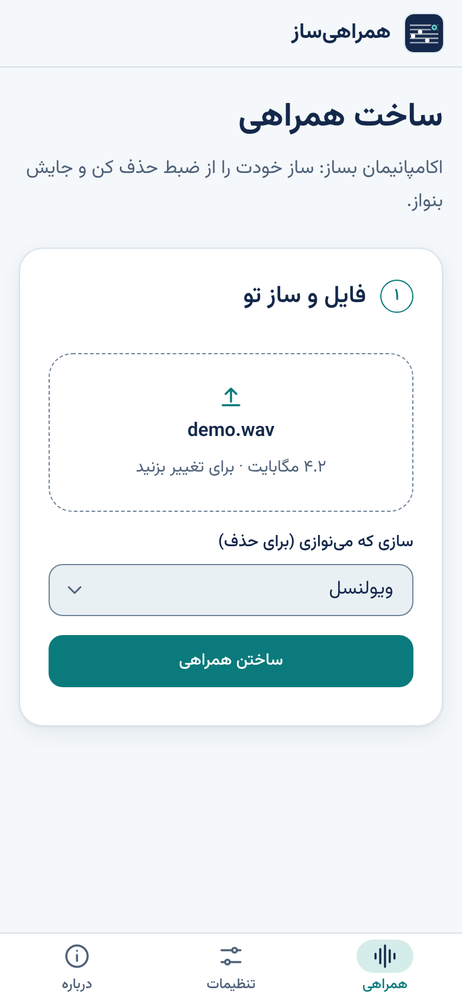
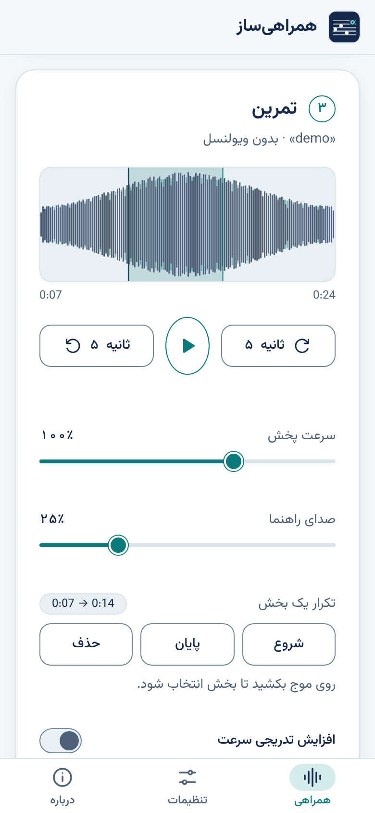
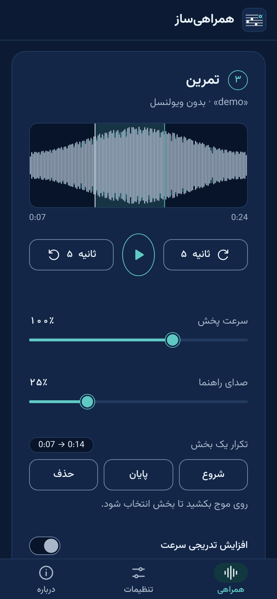
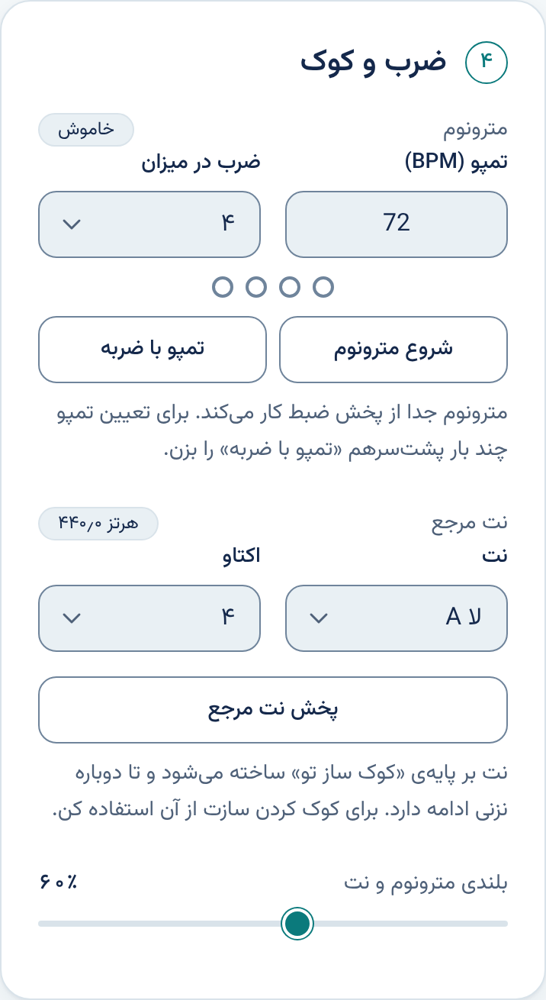
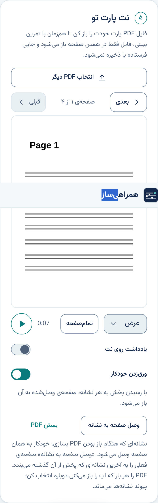

# Solo Remover (web)

Remove your own instrument from any recording (an orchestra, a band, an ensemble) and play along. This is the web version: it runs in the browser, needs no installation, and can record you playing over the accompaniment.

همراهی‌ساز: اکامپانیمان هر ضبطی را می‌سازد؛ ساز خودت را از ضبط حذف می‌کند و جایش می‌نوازی.

  
  
  

  
  

The screenshots use a short synthetic demo tone, not a real recording.

## Install

Open the GitHub Pages link in the repository description. On a phone, use "Add to Home screen" to install it like an app. Nothing else to install.

## Usage

1. Create a free account at [mvsep.com](https://mvsep.com) and copy your API key.
2. Open Settings in the app and paste the key. It is stored in your browser only.
3. Choose a recording and your instrument, press the main button and wait.
4. Practice in the player: loops, named markers, gradual speed, tuning, metronome, your own PDF part, and recording yourself (use headphones).

## Privacy

- Your recording goes to MVSEP through a small stateless relay (see `proxy/`) because MVSEP does not allow direct browser calls. The relay stores and logs nothing.
- Your MVSEP key travels with each request and is kept in your browser; it is never part of this repository.
- Microphone takes stay in memory until you close the page; nothing is uploaded.
- Markers, notes and the practice log stay on your device.

Only use recordings you have the right to use. MVSEP's free plan has its own limits.

## Build from source

The page is one self-contained `index.html` (design-system tokens and components inline) plus `config.js` (relay address), the manifest and icons. To run your own relay, deploy `proxy/Code.gs` as an Apps Script web app (Execute as: Me, Access: Anyone) and put its `/exec` URL in `config.js`. Serve over HTTPS (needed for the microphone).

## License

[MIT](LICENSE)

Font: [Vazirmatn](https://github.com/rastikerdar/vazirmatn) (OFL). MP3 encoding uses [lamejs](https://github.com/zhuker/lamejs) (LGPL-3.0) and PDF display uses [PDF.js](https://github.com/mozilla/pdf.js) (Apache-2.0); both are loaded at run time from a CDN, not bundled. Social icons: [Bootstrap Icons](https://github.com/twbs/icons) (MIT).

---

Made by [MohammadReza Tayebi](https://github.com/mimreta) · [Instagram](https://instagram.com/mimreta) · [LinkedIn](https://linkedin.com/in/mimreta) · [X](https://x.com/1mimreta) · [Telegram](https://t.me/wanderingkite)
